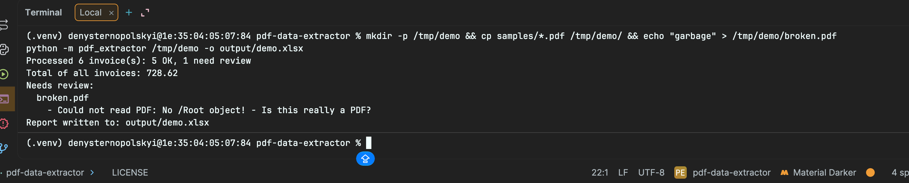
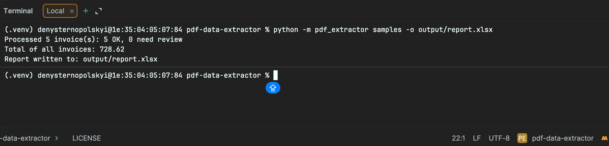
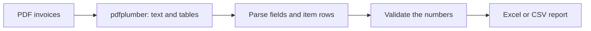

# PDF Data Extractor


A command-line tool that extracts fields and item tables from PDF invoices into Excel or CSV,
and **checks that the numbers add up**. Files it cannot trust are flagged for review instead of
silently producing wrong data.

> All sample invoices in this repository are fictional. They are generated by
> `pdf_extractor/sample_data.py`.

## Features

- Reads a single PDF or a whole folder of PDF invoices.
- Extracts invoice number, date, vendor, customer, every line item, subtotal, tax and total.
- Validates the data: quantity × price = line amount, items add up to the subtotal,
  subtotal + tax = total.
- Writes an Excel report with `Summary`, `Invoices` and `Items` sheets, or two CSV files.
- Flags problem files (`CHECK` status, pink rows) and lists the reasons in the terminal.
  One bad file never stops the rest.
- Runs offline, so confidential invoices never leave your machine.
- Ships as a small Docker image, with a CI pipeline on every push.

## Example

```
$ python -m pdf_extractor samples -o output/report.xlsx
Processed 5 invoice(s): 5 OK, 0 need review
Total of all invoices: 728.62
Report written to: output/report.xlsx
```

When something is wrong, the report is still created and the problem is explained:

```
Processed 6 invoice(s): 5 OK, 1 need review
Total of all invoices: 728.62
Needs review:
  broken.pdf
    - Could not read PDF: ...
Report written to: output/demo.xlsx
```

## Screenshots

**Terminal**



**Excel report**


**Problems are flagged, not hidden**



## Quick start (Docker)

```bash
git clone https://github.com/Denys33546/pdf-data-extractor.git
cd pdf-data-extractor
docker build -t pdf-extractor .
```

Try it on the bundled sample invoices:

```bash
mkdir -p output
docker run --rm -v "$PWD/output:/out" pdf-extractor samples -o /out/report.xlsx
```

Use your own PDFs (the input folder is mounted read-only):

```bash
docker run --rm -v "/path/to/pdfs:/in:ro" -v "$PWD/output:/out" \
  pdf-extractor /in -o /out/report.xlsx
```

On Linux, add `--user "$(id -u):$(id -g)"` so the report is written with your permissions.
Docker Compose works too: `docker compose run --rm extractor`.

## Run locally (without Docker)

Requires Python 3.12.

```bash
python -m venv .venv
source .venv/bin/activate
pip install -r requirements-dev.txt
python -m pdf_extractor samples -o output/report.xlsx
```

## Usage

```
python -m pdf_extractor INPUT [-o OUTPUT] [--strict] [--version]
```

| Argument | Description |
|---|---|
| `INPUT` | A PDF file or a folder with PDF files |
| `-o`, `--output` | Report file, `.xlsx` or `.csv` (default: `output/report.xlsx`) |
| `--strict` | Exit with code 1 if any invoice needs review |
| `--version` | Show the version |

**Excel report:** `Summary` (counts, total, totals per vendor), `Invoices` (one row per invoice
with status and warnings) and `Items` (one row per line item).
**CSV report:** `<name>_invoices.csv` and `<name>_items.csv`.

**Exit codes:** `0` report created, `1` nothing to process, report could not be written, or
`--strict` found problems, `2` invalid arguments.

To generate fictional sample invoices:

```bash
python -m pdf_extractor.sample_data samples --count 5
```

## How it works



Amounts are handled with `Decimal`, not `float`, so totals match to the cent.

## Supported invoices and limitations

This is a working demo for text-based PDFs (the kind exported from accounting software).

- **Scanned PDFs (images) are not supported** and are reported as such. They would need OCR.
- The parser expects these labels: `Invoice No`, `Date: YYYY-MM-DD`, `Bill To`, an item table
  with the header `Description | Qty | Unit Price | Amount`, and `Subtotal`, `Tax` and `Total`
  lines. The vendor is read from the first line.
- Invoices with a different layout need their own patterns in `pdf_extractor/extractor.py`.

## Security notes

- Text that looks like a spreadsheet formula (`=...`, `+...`, `-...`, `@...`) is kept as plain
  text in Excel and prefixed in CSV, so a malicious PDF cannot run code in your spreadsheet.
- The tool works offline and never modifies the input files.
- The Docker image runs as a non-root user.

## Tests and code quality

```bash
pytest --cov            # tests and coverage
ruff check .            # lint
ruff format --check .   # formatting
```

The tests generate PDFs, read them back and compare every field with the original data.
GitHub Actions runs lint, tests and a Docker build with a smoke test on every push.

## Project structure

```
pdf_extractor/
├── cli.py          # command line interface
├── extractor.py    # fields and tables from PDF, number checks
├── exporters.py    # Excel and CSV reports
└── sample_data.py  # fictional sample invoices
tests/              # pytest test suite
samples/            # sample invoices
Dockerfile
docker-compose.yml
.github/workflows/ci.yml
```

## Roadmap

- [x] Field and table extraction with validation
- [x] Excel and CSV export
- [x] Command line interface
- [x] Docker image
- [x] CI with lint, tests and Docker smoke test
- [ ] Configurable field patterns for other invoice layouts
- [ ] OCR for scanned PDFs
- [ ] Publish the Docker image to GitHub Container Registry

## License

MIT, see [LICENSE](LICENSE).
